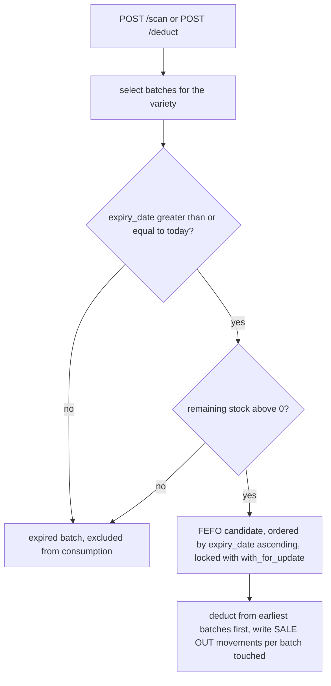
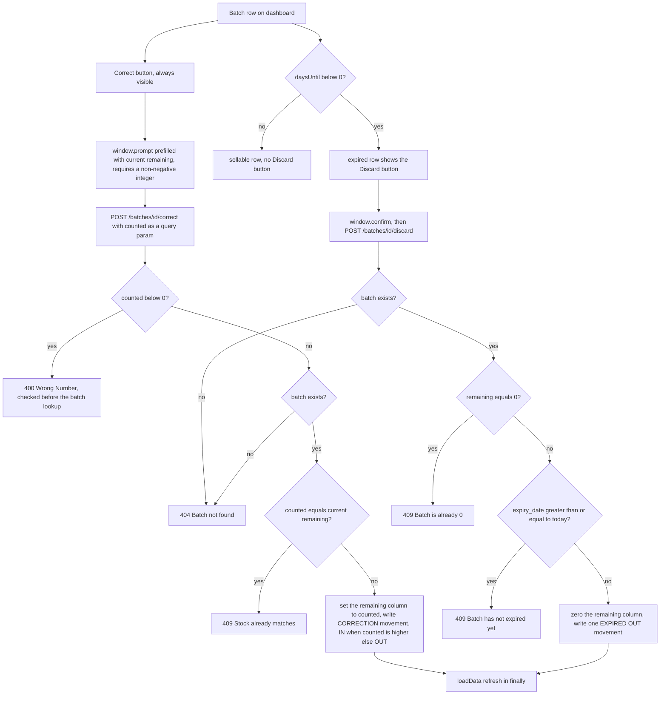

# Batch Lifecycle and Correction Workflows

A `Batch` (see [Domain Concepts](../domain/concepts.md)) moves through four write stages, each handled by a dedicated endpoint in `main.py` and each writing a `StockMovement` audit row whose `reason` identifies the stage:

| Stage | Endpoint | Movement written | Reason | Direction |
|---|---|---|---|---|
| Restock (new delivery) | `POST /batches` | one `IN` row mirroring the received quantity | `RESTOCK` | `IN` |
| Consumption (sale / manual removal) | `POST /scan`, `POST /deduct` | one `OUT` row per batch touched (+ one `batch_id=None` row on scan shortfall) | `SALE` | `OUT` |
| Discard (expired stock) | `POST /batches/{batch_id}/discard` | one `OUT` row with the full remaining quantity | `EXPIRED` | `OUT` |
| Correction (stock-take fix) | `POST /batches/{batch_id}/correct` | one `OUT` row when stock is lowered, one `IN` row when raised | `CORRECTION` | `OUT` / `IN` |

Two invariants hold across every stage:

- The `StockMovement.grams` column is **overloaded**: it carries grams for weight-tracked batches and the unit count for unit-tracked batches. Restock, scan, deduct, discard, and correct all write this one integer field, so the audit trail and the low-stock consumption sum (see [Workflows and Operations](operations.md)) stay consistent only as long as every handler keeps this convention.
- Expiry is **inclusive at the boundary**: a batch with `expiry_date >= date.today()` is still sellable and still blocked from discarding; only a *strictly past* expiry date makes a batch discardable.

*The sellable-vs-expired decision applied by both consumption endpoints: expiry day itself still counts as sellable, and batches that fail either check stay in the database untouched.*

## Stage 1: Restock (`POST /batches`)

A batch enters the system only through restock — there is no other batch-creation path.

- **Validation.** `BatchCreate` (`schemas.py`) carries optional `grams_remaining` and `units_remaining` plus a required `expiry_date`. Its `model_validator` rejects a payload where *both* quantity fields are `None` (`"Πρέπει να δώσεις είτε grams_remaining είτε units_remaining"`). The frontend enforces the mirror-image rule: `RestockModal.jsx` shows a grams field only for `weight` varieties and a units field only for `units` varieties, and sends the non-matching field as an explicit `null` — so in practice exactly one quantity is set.
- **Branch rule.** `create_batch` in `main.py` decides tracking by `new_batch.units_remaining is None`: if units is `None` the batch is weight-tracked, otherwise unit-tracked. Note the asymmetric implication — a payload setting *both* fields would pass the validator, create the batch, and have the `IN` movement mirror the *grams* value (the `units_remaining is None` branch is the else-case for units). The UI never produces such a payload, but API callers could; treat this as an input-trust boundary, not a guaranteed invariant.
- **Movement bookkeeping.** The handler inserts the `Batch` (with `received_at` defaulting to now-UTC), `db.flush()`es to obtain the batch id, then writes one `StockMovement` with `barcode=None`, `direction=IN`, `reason=RESTOCK`, and `grams` set to whichever quantity was provided — `grams_remaining` for weight, `units_remaining` for units. Everything commits in one transaction.
- **UI wiring.** `App.jsx` mounts `RestockModal` and calls `loadData()` in its `onSuccess`, closing the modal and refreshing `/varieties` + `/batches` immediately.

## Stage 2: Consumption (`POST /scan`, `POST /deduct`)

Both endpoints consume stock FEFO (first-expiring, first-out) and share the eligibility filter from the diagram above: `Batch.variety_id` match, `expiry_date >= date.today()`, positive remaining stock, `order_by(Batch.expiry_date)` ascending, and `.with_for_update()` row locks so concurrent scans serialize on the same batch rows.

- **Weight scan.** `remaining_to_subtract` starts at `product.package_size_grams` (a weight product without it is a `400`). The loop walks the batch chain, draining each batch (`batch.grams_remaining >= remaining` takes the remainder needed and zeroes nothing more; otherwise the whole batch is zeroed) and writing one `OUT`/`SALE` movement per batch touched, with `barcode=scan.barcode`. After the loop, any uncovered shortfall is recorded as **one extra movement with `batch_id=None`** — the comment in `main.py` explains the intent: the package physically left the shop, so the movements must add up to the full package size even when the on-file data disagrees, and the `batch_id=None` row flags that "someone has to look". The response carries `stock_shortfall` and `status`: `"completed"` when the shortfall is `0`, `"stock_mismatch"` otherwise.
- **Unit scan.** Exactly **one** unit is taken from the **first** non-expired batch with `units_remaining > 0` (`.first()`, not a loop) and one `OUT`/`SALE` movement with `grams=1` is written. If no such batch exists the endpoint returns `404 Batch not found`. There is no shortfall concept — the response is always `{"units_removed": 1, "status": "completed"}`.
- **Manual deduct** (`DeductModal.jsx` → `POST /deduct`) applies the same FEFO chain for both tracking types with `barcode=None` movements. Its behavioral asymmetries with `/scan` (weight deduct always reports `completed` without shortfall tracking; unit deduct chains across batches and reports `stock_mismatch`) are documented in detail in [Workflows and Operations](operations.md); this page records only that both deduct branches write per-batch `SALE`/`OUT` movements the same way the scan branch does.

*The dashboard entry points and the exact guard sequences of `POST /batches/{id}/discard` and `POST /batches/{id}/correct`; both write paths end in the same error-then-refresh `loadData()` call.*

## Stage 3: Discard (`POST /batches/{batch_id}/discard`)

Discard removes expired stock from the shelf and records it as waste. The guards run in this order, each with its own status code:

1. **404** — no `Batch` with that id (`"Batch not found"`).
2. **409 "Batch is already 0"** — `batch.grams_remaining == 0 or batch.units_remaining == 0`. This works despite the other column being `None` because Python evaluates `None == 0` as false: for a weight batch only `grams_remaining` can trip the guard, for a unit batch only `units_remaining`. A fully consumed batch therefore cannot be discarded (and is also filtered out of the dashboard, see below).
3. **409 "Batch hasn't expired yet"** — `batch.expiry_date >= date.today()`. Only a **strictly past** expiry date may be discarded; a batch expiring *today* is still sellable and is refused here.

On success the handler zeroes whichever column is not `None` (`grams_remaining` for weight, else `units_remaining`) and writes **one** `StockMovement` with `barcode=None`, `direction=OUT`, `reason=EXPIRED`, and `grams` set to the full remaining quantity that was just zeroed. The response reports the batch id and its expiry date. The waste report (`/reports/waste`) aggregates exactly these `EXPIRED` movements per variety.

## Stage 4: Correction (`POST /batches/{batch_id}/correct?counted=N`)

Correction implements a manual stock-take: the operator counts what is physically on the shelf and the batch is forced to that value. Guards, in the order `main.py` evaluates them:

1. **400 "Wrong Number"** — `counted < 0`. Note the ordering quirk: this check runs **before** the batch lookup, so a negative `counted` against an unknown batch id returns `400`, not `404`.
2. **404 "Batch not found"** — no batch with that id.
3. **409 "Stock already matches"** — `counted` equals the batch's current remaining value (`grams_remaining` or `units_remaining`). A no-op correction is refused rather than silently writing a zero-sized movement.

On success the handler sets the remaining column to `counted` and writes one `CORRECTION` movement with `barcode=None`:

- `counted` **higher** than current → `direction=IN`, `grams = counted - current` (found stock).
- `counted` **lower** → `direction=OUT`, `grams = current - counted` (missing stock).

The branch is selected per tracking type (`batch.grams_remaining is not None` → weight path, else units path), and both paths are structurally identical. Unlike discard, correction has **no expiry guard** — an expired batch can still be corrected.

## UI seam: batch rows, Discard visibility, and the correct prompt

`App.jsx` owns the dashboard wiring for the two late-stage actions:

- **Batch rows.** `BatchRow` computes `daysUntil(batch.expiry_date)` (date-only difference) and `urgencyLevel`: `expired` when `days < 0`, `critical` at `≤ 3` days, `soon` at `≤ 10`, otherwise `fresh`; the level becomes the row's CSS modifier class, and the label reads `Expired Nd ago` / `Expires Today` / `Nd left`. `VarietySection` lists each variety's batches sorted by `expiry_date`, filtering to batches with remaining stock above 0 — so fully consumed batches disappear from the screen, and the headline "total" deliberately sums **only batches with `daysUntil >= 0`**: expired batches stay listed (so they can be discarded) but don't count toward the sellable total, matching the API's eligibility rule.
- **Discard visibility.** The Discard button renders only when `days < 0`, with an inline comment stating this is "same rule as the API": on its expiry day a batch is still sold, so only batches past that day can be discarded. Clicking it asks `window.confirm` (`"Throw away {quantity} that expired on {date}?"`) before POSTing to `/batches/{id}/discard`.
- **Correct prompt.** The pencil button is always visible on a batch row. `handleCorrect` opens `window.prompt` prefilled with the current remaining value, requires a **non-negative integer** (`Number.isInteger(counted) && counted >= 0`, otherwise a local error message and no request), then POSTs `counted` as a query parameter and reports `Corrected {current} → {counted}`.
- **Error-then-refresh.** Both `handleDiscard` and `handleCorrect` call `loadData()` in the `finally` block — on failure as well as success. This is deliberate (see the comment in `handleDiscard`): a `409` means the on-screen list was stale (e.g. the batch was already emptied by a concurrent scan), so the UI surfaces the server's `detail` message via `scanMessage` and immediately re-fetches `/varieties` + `/batches` to reconcile the screen with the database. The dashboard also polls the same pair every 10 seconds as a baseline.

## Testing notes

There is no automated suite guarding any of this; [Testing and Validation](../testing.md) describes the manual strategy. For this page's surface specifically, the highest-value manual checks are the guard boundaries:

- Discard a batch expiring **today** → expect `409 "Batch hasn't expired yet"`; discard one expired yesterday → expect the stock zeroed and one `EXPIRED` `OUT` movement.
- Correct with `counted` equal to the current remaining → expect `409 "Stock already matches"` and **no** movement row; correct upward and downward once each and verify the `IN`/`OUT` direction flip.
- Correct with a negative value against an unknown id → expect `400` (the guard precedes the `404` lookup).
- Scan a weight product larger than the stock on file → expect `status: "stock_mismatch"` with a `stock_shortfall` and a `batch_id=None` movement whose grams equals the shortfall.
- Correct or discard from the UI while another client has already emptied the batch → expect the error message and an immediate refresh, not a stuck stale row.
